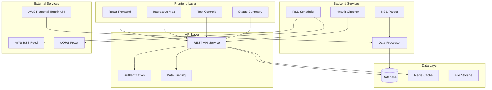
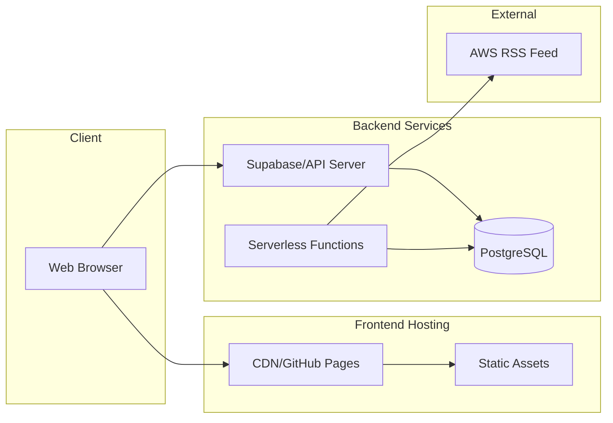
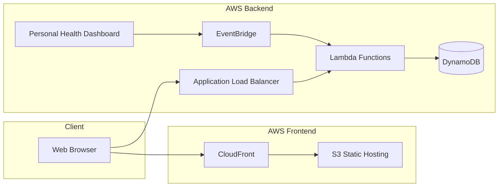
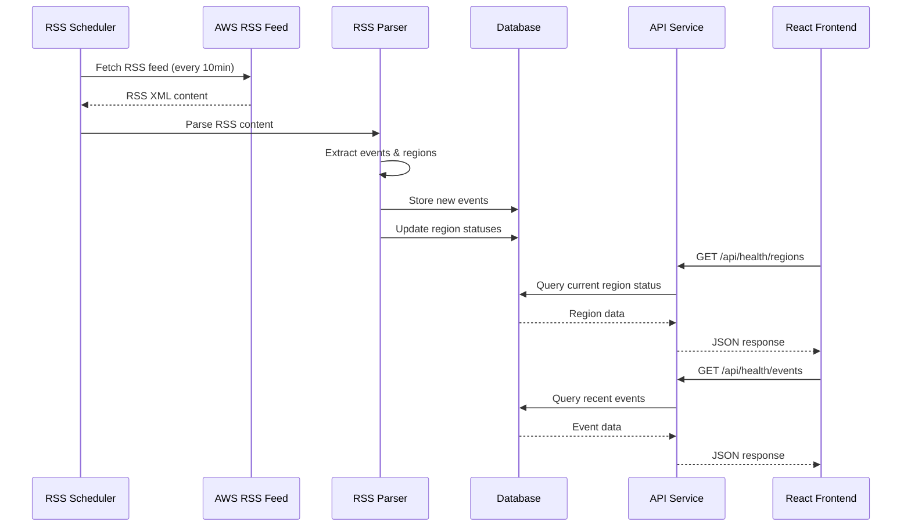

# CloudHealth Map Enhancement - Design Document

## Overview

The CloudHealth Map is a comprehensive AWS health monitoring system that combines a modern React frontend with a robust backend service architecture. The system provides real-time visualization of AWS service health across global regions through an interactive map interface, backed by centralized data persistence and automated data collection services.

The design supports multiple deployment architectures (V2 database-backed, V3 AWS-native) while maintaining consistent user experience and data schemas. The system emphasizes reliability, scalability, and comprehensive monitoring capabilities for both public AWS status monitoring and future personal health dashboard integration.

## Architecture

### High-Level System Architecture



### Deployment Architecture Options

#### V2: Database-Backed Architecture


#### V3: AWS-Native Architecture


## Components and Interfaces

### Frontend Components

#### Core UI Components
- **RegionMap**: Interactive Leaflet.js map with AWS region markers
- **RegionSummary**: Dashboard cards showing operational/issue/outage counts
- **StatusLog**: Chronological list of recent AWS service events
- **TestControls**: Developer tools for simulating region status changes

#### Component Interfaces
```typescript
interface AWSRegion {
  name: string;
  code: string;
  location: [number, number]; // [longitude, latitude]
  status: "operational" | "issue" | "outage";
}

interface RSSItem {
  title: string;
  description: string;
  pubDate: string;
  guid: string;
  region?: string;
  status?: "operational" | "issue" | "outage";
}

interface HealthData {
  regions: AWSRegion[];
  recentItems: RSSItem[];
  lastBuildDate: string | null;
  lastUpdateTime: string;
}
```

### Backend API Endpoints

#### Health Data API
```typescript
// GET /api/health/regions
// Returns current status of all AWS regions
interface RegionsResponse {
  regions: AWSRegion[];
  lastUpdate: string;
  metadata: {
    totalRegions: number;
    operational: number;
    issues: number;
    outages: number;
  };
}

// GET /api/health/events
// Returns recent health events with pagination
interface EventsResponse {
  events: RSSItem[];
  pagination: {
    page: number;
    limit: number;
    total: number;
    hasMore: boolean;
  };
  lastUpdate: string;
}

// GET /api/health/events/{regionCode}
// Returns events for specific region
interface RegionEventsResponse {
  region: string;
  events: RSSItem[];
  currentStatus: "operational" | "issue" | "outage";
}
```

#### Test/Simulation API
```typescript
// POST /api/test/simulate
// Creates simulated health events for testing
interface SimulateRequest {
  regionCode: string;
  status: "issue" | "outage";
  duration?: number; // minutes
  description?: string;
}

interface SimulateResponse {
  success: boolean;
  simulationId: string;
  expiresAt: string;
}

// DELETE /api/test/simulate/{simulationId}
// Removes active simulation
```

### Backend Services

#### RSS Data Collection Service
```typescript
class RSSCollectionService {
  async fetchAWSRSSFeed(): Promise<RSSItem[]>
  async parseRSSContent(content: string): Promise<RSSItem[]>
  async processHealthEvents(items: RSSItem[]): Promise<void>
  async updateRegionStatuses(): Promise<void>
}
```

#### Data Processing Service
```typescript
class DataProcessingService {
  async deduplicateEvents(events: RSSItem[]): Promise<RSSItem[]>
  async extractRegionFromEvent(event: RSSItem): Promise<string | null>
  async determineStatusFromEvent(event: RSSItem): Promise<string>
  async calculateRegionStatus(regionCode: string): Promise<string>
}
```

#### Notification Service
```typescript
class NotificationService {
  async sendStatusChangeAlert(region: string, oldStatus: string, newStatus: string): Promise<void>
  async sendTestNotification(simulation: SimulateRequest): Promise<void>
}
```

## Data Models

### Database Schema

#### Health Events Table
```sql
CREATE TABLE health_events (
  id UUID PRIMARY KEY DEFAULT gen_random_uuid(),
  guid VARCHAR(255) UNIQUE NOT NULL,
  title TEXT NOT NULL,
  description TEXT,
  pub_date TIMESTAMP WITH TIME ZONE NOT NULL,
  region_code VARCHAR(20),
  status VARCHAR(20) CHECK (status IN ('operational', 'issue', 'outage')),
  source VARCHAR(50) DEFAULT 'aws_rss',
  created_at TIMESTAMP WITH TIME ZONE DEFAULT NOW(),
  updated_at TIMESTAMP WITH TIME ZONE DEFAULT NOW()
);

CREATE INDEX idx_health_events_region_date ON health_events(region_code, pub_date DESC);
CREATE INDEX idx_health_events_status ON health_events(status);
CREATE INDEX idx_health_events_pub_date ON health_events(pub_date DESC);
```

#### Region Status Table
```sql
CREATE TABLE region_status (
  region_code VARCHAR(20) PRIMARY KEY,
  region_name VARCHAR(100) NOT NULL,
  current_status VARCHAR(20) NOT NULL CHECK (current_status IN ('operational', 'issue', 'outage')),
  last_status_change TIMESTAMP WITH TIME ZONE,
  last_event_id UUID REFERENCES health_events(id),
  latitude DECIMAL(10, 8) NOT NULL,
  longitude DECIMAL(11, 8) NOT NULL,
  created_at TIMESTAMP WITH TIME ZONE DEFAULT NOW(),
  updated_at TIMESTAMP WITH TIME ZONE DEFAULT NOW()
);
```

#### Test Simulations Table
```sql
CREATE TABLE test_simulations (
  id UUID PRIMARY KEY DEFAULT gen_random_uuid(),
  region_code VARCHAR(20) NOT NULL,
  simulated_status VARCHAR(20) NOT NULL CHECK (simulated_status IN ('issue', 'outage')),
  description TEXT,
  created_by VARCHAR(100),
  expires_at TIMESTAMP WITH TIME ZONE,
  is_active BOOLEAN DEFAULT true,
  created_at TIMESTAMP WITH TIME ZONE DEFAULT NOW()
);

CREATE INDEX idx_test_simulations_active ON test_simulations(is_active, expires_at);
```

### Data Flow Architecture



## Error Handling

### Frontend Error Handling
- **Network Failures**: Graceful degradation with cached data display
- **API Timeouts**: Retry logic with exponential backoff
- **Invalid Data**: Input validation and sanitization
- **UI Errors**: Error boundaries with user-friendly messages

### Backend Error Handling
- **RSS Feed Failures**: CORS proxy fallback and cached data serving
- **Database Errors**: Connection pooling, retry logic, and circuit breakers
- **Rate Limiting**: Proper HTTP status codes and retry headers
- **Data Validation**: Schema validation and sanitization

### Error Response Format
```typescript
interface ErrorResponse {
  error: {
    code: string;
    message: string;
    details?: any;
    timestamp: string;
    requestId: string;
  };
}
```

## Testing Strategy

### Frontend Testing
- **Unit Tests**: Component logic, utility functions, data transformations
- **Integration Tests**: Component interactions, API integration, state management
- **E2E Tests**: Complete user workflows, cross-browser compatibility
- **Visual Tests**: UI consistency, responsive design, accessibility

### Backend Testing
- **Unit Tests**: Service methods, data processing, validation logic
- **Integration Tests**: Database operations, API endpoints, external service integration
- **Load Tests**: Performance under concurrent users, database query optimization
- **Security Tests**: Authentication, authorization, input validation, SQL injection prevention

### Test Automation Framework
```typescript
// Test Categories
interface TestSuite {
  unit: {
    statusMapping: Test[];
    dataProcessing: Test[];
    apiEndpoints: Test[];
  };
  integration: {
    databaseOperations: Test[];
    rssProcessing: Test[];
    frontendBackend: Test[];
  };
  e2e: {
    userWorkflows: Test[];
    statusSimulation: Test[];
    errorHandling: Test[];
  };
}
```

### CI/CD Pipeline Testing
- **Build Validation**: TypeScript compilation, linting, security audits
- **Automated Testing**: Full test suite execution with coverage reporting
- **Performance Monitoring**: Bundle size analysis, load time metrics
- **Security Scanning**: Dependency vulnerabilities, code security analysis

## Performance Considerations

### Frontend Optimization
- **Bundle Splitting**: Code splitting for optimal loading
- **Caching Strategy**: Service worker for offline capability
- **Image Optimization**: Optimized flag images and map tiles
- **Lazy Loading**: Component and route-based lazy loading

### Backend Optimization
- **Database Indexing**: Optimized queries for region and event data
- **Caching Layer**: Redis for frequently accessed data
- **Connection Pooling**: Efficient database connection management
- **Rate Limiting**: API protection and resource management

### Scalability Design
- **Horizontal Scaling**: Stateless service design for load balancing
- **Database Sharding**: Region-based data partitioning if needed
- **CDN Integration**: Global content delivery for static assets
- **Auto-scaling**: Dynamic resource allocation based on load

## Security Considerations

### Authentication & Authorization
- **API Keys**: Secure API access for backend services
- **CORS Configuration**: Proper cross-origin resource sharing setup
- **Rate Limiting**: Protection against abuse and DoS attacks
- **Input Validation**: Comprehensive data sanitization

### Data Protection
- **Encryption**: TLS for data in transit, encryption for sensitive data at rest
- **Access Control**: Role-based access for administrative functions
- **Audit Logging**: Comprehensive logging for security monitoring
- **Privacy Compliance**: Data retention policies and user privacy protection

### Infrastructure Security
- **Environment Variables**: Secure configuration management
- **Network Security**: VPC configuration, firewall rules
- **Monitoring**: Security event detection and alerting
- **Backup & Recovery**: Secure data backup and disaster recovery procedures